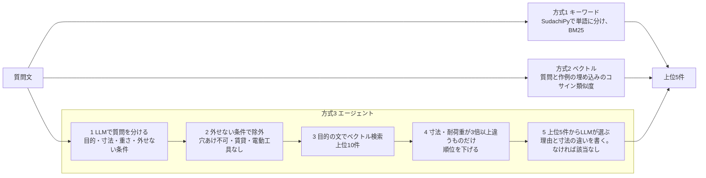

# DIY作例ナビ（PoC）

やりたいことを普段の言葉で入力すると、**寸法が違っても参考になるDIY作例**を探し、違いと必要な材料を添えて返す検索のPoCです。キーワード検索・ベクトル検索・LLMを使った検索（エージェント）の3方式を、同じ質問で比べました。

```
入力：幅60センチ、奥行き30センチの板で本棚を作りたいのですが。

1. EX01 幅60cmのウォールシェルフ（L字金具で壁付け）
   理由：指定された幅60cmの板をL字金具で壁に取り付けることで、壁面に本棚を作ることができます。
   違い：奥行きが15cmから30cmに変わるため、奥行きに合わせた大きめのL字金具（棚受け）に変更してください。
2. EX02 幅90cmのウォールシェルフ（L字金具で壁付け）
   違い：幅90cm・奥行20cmの作例ですが、ご希望の幅60cm・奥行30cmの板とそれに合う棚受け金具に変更すればそのまま作れます。
3. EX18 すのこで作る靴棚（幅60cm・4段）
   違い：靴用のすのこ棚ですが、本棚として使う場合は強度を持たせるために板材をすのこから厚めの木板に変更してください。

読み取った要望：目的「本棚を自作する」、幅60cm・奥行30cm
足りない情報：高さ（または段数）、載せる本の総重量、設置場所の制約、使用できる工具
```

（方式3の実際の出力。読みやすく整形しています。APIの応答には、各作例の材料一覧も入ります）

## なぜ作ったか

ホームセンターで、欲しい物の売り場が分からなかったことがあります。「玄関で傘をまとめたい」のように**やりたいことは言えるのに、商品名や作り方の名前が分からない**ため、案内板や検索に合う言葉が出てきませんでした。

作例を探すときも同じで、言葉が一致しないとキーワード検索では見つかりません。また、寸法がぴったり同じ作例はほとんどありません。「幅を変えれば作れる」作例を、違いの説明つきで出せれば、店頭の端末やスマホで店員さんに聞くように使えるのではないかと考えました。

## 仕組み



- 3方式とも、同じ `Searcher` の形（`search(query, k=5) -> list[Result]`）にしています
- 方式3は、ツール呼び出し型のエージェントではなく、**手順を決めたパイプライン**です。処理の中身を見えるようにするため、LangChainなどの枠組みは使っていません
- **寸法では除外しません**。寸法が違っても参考になる作例を出すためです。桁が違うもの（3倍以上の差）だけ順位を下げます
- 作例は30件なので、DBは使わず、numpyで計算しています

| 部分 | 使ったもの |
|---|---|
| 言語・パッケージ管理 | Python 3.12、uv |
| REST API | FastAPI（入出力はPydanticの型） |
| キーワード検索 | SudachiPy（辞書core、正規化形）、bm25s |
| LLM・埋め込み | Gemini API（`gemini-3.6-flash`、`gemini-embedding-2`）、SDK `google-genai` |
| テスト | pytest（APIを呼ばない部分だけ） |

## 結果

testの質問（ChatGPTが作った20問）で、3方式を1回だけ評価しました（[results/20261108-2144.md](results/20261108-2144.md)）。

| 方式 | Hit@5 | Top1 | 該当なしの正答率 | 平均応答時間 | 1問あたりの費用 |
|---|---|---|---|---|---|
| キーワード | 100% | 83% | 対象外 | 0.00秒 | $0 |
| ベクトル | 100% | 94% | 対象外 | 0.44秒 | 約$0.00001 |
| エージェント | 94% | 94% | 50%（1/2） | 4.31秒 | 約$0.0023 |

- 当たりは、人が付けたgrade 1以上（2＝そのまま使える、1＝寸法や材料を変えれば参考になる）です
- Hit@5：上位5件に当たりが1件以上ある割合。Top1：1位が当たりの割合。分母は、当たりがある18問です
- 該当なしの正答率：当たりがない2問で、方式3が「該当なし」と返せた割合です。方式1・2は必ず何かを返すので、対象外です
- 費用は、応答のトークン数を有料枠の料金（チャット：入力$0.75・出力$3.75／100万トークン、埋め込み：$0.20／100万トークン）で換算した概算です

### 分かったこと

**1. 方式の差は、偶然の範囲かもしれない**

当たりがある18問では、方式の差は1〜2問です。質問がこれだけ少ないと、この差に意味があるとは言えません。

**2. ChatGPTが作った質問は、作例と言葉が近かった**

キーワード検索でも、Hit@5が100%になりました。質問を作ったLLMと作例を作ったLLMは別の会社のもので、互いを見せていません。それでも、DIYの説明によく出る言葉（「棚」「突っ張り」「すのこ」など）が、両方に入っていました。

**3. 自分で書いた質問は、どの方式でもほとんど当たらなかった**

作例を見る前に自分で書いた5問は、別に集計しています。

| 方式 | 当たりがある問題数 | Hit@5 | Top1 | 該当なしの正答率 |
|---|---|---|---|---|
| キーワード | 3 | 33% | 0% | 対象外 |
| ベクトル | 3 | 33% | 0% | 対象外 |
| エージェント | 3 | 0% | 0% | 50%（1/2） |

| id | 自分で書いた質問 | 当たりの作例 |
|---|---|---|
| O01 | 犬小屋を作りたいのですが、屋根につかえる素材を探しています。DIY初心者でも作れるもので、加工技術いらないものがよいです。サイズは長さ1m*幅50cm*高さは20cmぐらいです。 | 2件（grade 1） |
| O02 | 壁をリフォームしたいのでおすすめの素材を使いたい。壁一面に使えるもので、賃貸なので撤去時にもクリーナップしやすいのが良い。高さ2m、よこ3mぐらい | 2件（grade 2と1） |
| O03 | トイレのリノベーションしたい。防水加工されている素材がいい。 | 8件（grade 1） |
| O04 | 椅子をペンキで塗り直したい。白色がいい。できれば安いのがいい。 | なし |
| O05 | 間接照明つくりたい。照明とそれを覆うなにかがほしいです。大きさはチワワぐらい。 | なし |

LLMが作った質問では見えなかった、実際の言葉と作例のずれが2つありました。

- **作例の範囲から外れた相談が多い**：犬小屋、壁のリフォーム、トイレ、椅子の塗装、照明は、30件の作例の分類（棚・収納、目隠し、補修 など）の外です。5問中2問は、当たりの作例が1件もありませんでした
- **作例ではなく、素材を探す相談がある**：O01は、作り方より「屋根に使える素材」を探しています。O02も、作例を求めつつ「おすすめの素材」を知りたい相談です。作例を返すだけでは答えきれず、材料から売り場への案内（「今後」）が要ります。一方、O03は作例を探していて、「防水加工」は素材の条件として書いています

### 外れた例の分析（方式3）

**T15「一人暮らしで電動工具がないのですが、壁に棚を付けられますか？」**

- 方式3は「電動工具を使えない」を外せない条件と読み取り、電動ドリルを使う作例をすべて除外しました。残った候補から、石こうボード用ピンの小物掛け（EX08、grade 0）だけを返しました
- 人がgrade 1・2を付けた棚の作例（EX01・EX02・EX04・EX05）は、どれも電動ドリルを使います
- 結果を見た後に確かめたところ、**人の判定の見落とし**でした。判定のときに作例の「工具」の欄を見ておらず、電動工具が要ることに気づいていませんでした。この質問に限っては、方式3の除外のほうが質問の条件に合っています
- 正解は、システムの結果を見る前に付けるものなので、結果を見た後には直していません。そのため、この1問は「外れ」として数えたままです
- 人が判定するときも、寸法や目的だけでなく、工具や条件の欄まで見る必要があります。30件×質問の数の組を1人で見ると、こうした見落としが起きやすいことも分かりました

**T20「子どもの夏休みの工作で、木製の貯金箱を作りたいです。」（該当なし）**

- 「該当なし」が正しい答えですが、方式3は木製の箱の作例（ケーブルボックス など）を3件返しました
- devの質問で「選ぶ基準が厳しすぎる」問題を直すために、選ぶときの指示を緩めた副作用だと考えています（次の「調整の記録」）

### 調整の記録（devの質問だけで実施）

調整は、devの10問だけで行いました。testの質問は、調整が終わった後に1回だけ使いました。

| | Hit@5 | Top1 | 該当なしの正答率 |
|---|---|---|---|
| 調整前（[results/20261108-1843-dev.md](results/20261108-1843-dev.md)） | 62% | 62% | 100%（2/2） |
| 調整後（[results/20261108-2137-dev.md](results/20261108-2137-dev.md)） | 88% | 75% | 100%（2/2） |

調整前の方式3は、当たりがある質問でも「該当なし」と答えすぎていました。中身を見て、次の2つを直しました。

1. **選ぶときの指示を緩めた**：「ぴったり合うもの」ではなく「店員さんが『少し変えれば作れますよ』と見せられるもの」を選ぶ指示にした。絵本の収納の質問で、当たりの作例が候補にあるのに、全部を不採用にしていたため
2. **「屋外で使う」を除外の条件から外した**：ベランダの物干しの質問で、室内用の突っ張り棒の作例（grade 1）が除外されていたため。室内用の作り方でも、材料や塗装を変えれば屋外で使えることがある。穴あけ不可・賃貸・電動工具なしは、作り方を変えても満たせないと考え、除外の条件に残した

devで当たりがある質問は8問なので、それ以上の調整はしていません。8問に合わせすぎると、testの結果が実力より悪く出るためです。

## データの作り方と限界

作例（Claude）・質問（ChatGPT）・検索（Gemini）は、それぞれ別の会社のLLMで、互いを見せずに作りました。同じLLMで作ると、言葉の癖が一致して、検索が実際より良く見えるおそれがあるためです。

### 作例（[data/examples.json](data/examples.json)）

- **架空のデータです。強度・耐荷重・安全性は保証しません**。実際に作るときは、専門の情報を確認してください
- Claudeが下書きし、別のClaudeが見直しました。直す内容は人が確認しました
- 作例を作るときは、評価用の質問を見せていません。質問を見た作業とは別の作業で作りました
- 8分類で各3〜4件、合計30件です。紛らわしい組（幅60cmと幅90cmの棚、室内用と屋外用 など）を入れています
- 「穴あけ不要」（そもそも壁を使わない）と「壁に穴をあけない」（壁を使うが、突っ張りなどで穴をあけない）は、別の条件として書き分けています

### 評価用の質問（[eval/](eval/)）

- ChatGPT（GPT-6.1 Terra）で生成しました。作例は見せず、店のDIY相談コーナーの分野名（8分類）と、質問の型の説明だけを渡しました。生成の記録は [eval/raw/](eval/raw/) にあります
- 30問のうち、不自然な文の1問だけを人が直しました
- dev 10問（調整用）、test 20問（評価用）に分けています
- これに、作例を見る前に自分で書いた5問を加え、別に集計しています
- 実際のお客さんの質問ではないので、結果は参考値です

### 正解（[eval/judgments.csv](eval/judgments.csv)）

- 3段階（2＝そのまま使える、1＝寸法や材料を変えれば参考になる、0＝使えない）で、システムを動かす前に人が付けました
- ChatGPTが「該当なし」の型で作った質問には、最初、人が無理に当てはめた正解を付けていました。質問の型に合わせて、その正解を外しています

### その他の限界

- LLMのtemperatureは0にしていますが、結果は完全には固定されません。同じ質問でも、回すたびに少し変わることがあります
- `gemini-embedding-2` は、埋め込みの用途を指定する `task_type` を無視します。最初はこれに気づかず、類似度がどの作例でも0.5前後になり、検索がうまく働きませんでした。代わりに、本文の先頭に用途を書いています（質問：`task: search result | query: `、作例：`title: none | text: `）
- 料金は公開情報から換算した概算です

## 今後

- **DB化**：作例が増えたら、PostgreSQL＋pgvectorに移す
- **聞き返し**：方式3は「足りない情報」（高さ、載せる物の重さ など）を読み取れているので、それを聞き返す
- **材料から売り場への案内**：作例の材料一覧から、店の売り場へ案内する（このPoCを作るきっかけになった困りごと）
- **正解の付け方の見直し**：作例の工具や条件の欄まで見て判定する。複数人で判定して、見落としや判断の違いを減らす（T15の見落としから）
- **ツール呼び出し型のエージェントとの比較**：手順を決めたパイプラインと、LLMが自分で検索を選ぶ方式を比べる
- **作例の範囲を広げる**：自分の質問のように、作例の範囲外の相談（素材探し、リフォーム など）にどう応えるか

## 動かし方

前提：Python 3.12、[uv](https://docs.astral.sh/uv/)、Gemini APIのキー

```bash
export GEMINI_API_KEY=...       # ファイルには書かない
uv sync

uv run pytest                   # テスト（APIを呼ばない）
uv run serve                    # API（http://127.0.0.1:8000）
curl -G "http://127.0.0.1:8000/search" --data-urlencode "q=玄関で傘をまとめたい" -d method=agent

uv run eval                     # testの質問で3方式を評価し、results/ に出力
uv run eval --set dev           # devの質問で評価
uv run eval --rebuild results/XXXX.json   # APIを呼ばずに、記録から表だけ作り直す
uv run check-models             # 使えるモデルの確認
```

- `method` は `keyword`・`vector`・`agent` のどれか（省略すると `agent`）
- 応答には、作例の全項目（材料を含む）、方式3の理由と寸法の違い、読み取った要望が入ります
- モデルは環境変数 `DIY_CHAT_MODEL`・`DIY_EMBED_MODEL` で切り替えられます
- 作例の埋め込みは、初回に計算して `.cache/` に保存します
- testの評価1回の費用は、有料枠で約$0.06です
